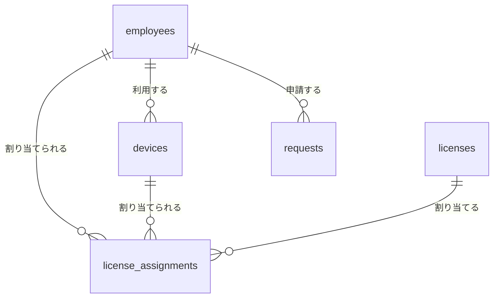

# 基本設計書（データベース）

| 項目 | 内容 |
|---|---|
| 版数 | 0.1 |
| 作成日 | 2026-10-31 |
| 前提文書 | [要件定義書](requirements.md)、[技術選定書](tech-selection.md) |

## 1. 設計方針

- データベースはSQLiteを使い、1つのファイル（`assets.db`）に保存する
- PC・モニター・スマートフォンは **1つのテーブル（devices）にまとめる**
  - 理由：「自分の資産の確認」（UC-02）や棚卸（UC-17）など、種別をまたいで機器を扱う処理が多いため
  - 欠点：種別によっては使わない列（PCの電話番号など）が空欄になる。これは許容する
- 状態や権限などの値は、**英語の短いコード**で保存し、画面では日本語で表示する
  - 理由：画面の表示名を変えても、保存済みのデータに影響しないため
- 計算で求められる値（ライセンスの残数など）は保存せず、必要なときに計算する
  - 理由：同じ情報を2か所に持つと、片方だけ更新されて食い違う「二重管理」が起きるため
- データは物理削除しない。廃棄・退職は状態の変更で表す（要件定義書 N-10）
- 日付は `YYYY-MM-DD`、日時は `YYYY-MM-DD HH:MM:SS` の文字列で保存する（SQLiteには日付専用の型がないため）

## 2. テーブル一覧

| テーブル名 | 日本語名 | 初回に作るか | 関連する要件 |
|---|---|:---:|---|
| employees | 社員 | ○ | F-01, F-02, F-54 |
| devices | 機器 | ○ | F-11〜F-17, F-25 |
| licenses | ライセンス | ○ | F-31, F-33 |
| license_assignments | ライセンス割当 | ○ | F-32 |
| requests | 申請 | 後で | F-21〜F-26 |
| audit_logs | 操作履歴 | 後で | F-53 |
| inventories | 棚卸 | 後で | F-41〜F-43 |

## 3. テーブルの関係（ER図）

- `||--o{` は「1対多」を表す。例：1人の社員は0台以上の機器を利用する

## 4. テーブル定義（初回に作るもの）

列の「制約」の意味：

| 制約 | 意味 |
|---|---|
| 主キー | 行ごとに重ならない番号。自動で付く |
| 必須 | 空欄にできない |
| 重複不可 | 同じ値を2回登録できない |
| 外部キー | 別のテーブルの行を指す番号 |

### 4.1 employees（社員）

| 列名 | 日本語名 | 型 | 制約 | 例 |
|---|---|---|---|---|
| id | ID | 整数 | 主キー | 1 |
| employee_code | 社員番号 | 文字 | 必須・重複不可 | E0001 |
| name | 氏名 | 文字 | 必須 | 山田 太郎（架空） |
| department | 部署 | 文字 | 必須 | 営業部 |
| email | メールアドレス | 文字 | 必須・重複不可 | yamada@example.com |
| role | 権限 | 文字 | 必須（`user` / `admin`） | user |
| password_hash | パスワード（ハッシュ化） | 文字 | 必須 | （元に戻せない文字列） |
| is_active | 在籍中か | 整数 | 必須（1＝在籍、0＝退職） | 1 |
| created_at | 登録日時 | 文字 | 必須 | 2026-11-01 09:00:00 |

### 4.2 devices（機器）

| 列名 | 日本語名 | 型 | 制約 | 使う種別 | 例 |
|---|---|---|---|---|---|
| id | ID | 整数 | 主キー | 全部 | 1 |
| asset_no | 資産番号 | 文字 | 必須・重複不可 | 全部 | PC-0001 |
| category | 種別 | 文字 | 必須（`pc` / `monitor` / `smartphone`） | 全部 | pc |
| maker | メーカー | 文字 | 必須 | 全部 | （架空のメーカー名） |
| model | 型番 | 文字 | 必須 | 全部 | NB-1400 |
| serial_no | シリアル番号 | 文字 | 必須・重複不可 | 全部 | SN12345678 |
| status | 状態 | 文字 | 必須（5章参照） | 全部 | in_stock |
| employee_id | 利用者 | 整数 | 外部キー（employees）。空欄可 | 全部 | 3 |
| location | 設置場所 | 文字 | | 全部 | 本社3F |
| purchase_date | 購入日 | 文字 | | 全部 | 2025-04-01 |
| warranty_end | 保証期限 | 文字 | | 全部 | 2028-03-31 |
| os | OS | 文字 | | PC | Windows 11 |
| screen_size | 画面サイズ（インチ） | 小数 | | モニター | 24 |
| imei | IMEI | 文字 | 重複不可。空欄可 | スマホ | 350000000000001 |
| phone_number | 電話番号 | 文字 | | スマホ | 090-0000-0001（架空） |
| carrier | 通信キャリア | 文字 | | スマホ | （架空のキャリア名） |
| contract_end | 契約期限 | 文字 | | スマホ | 2027-03-31 |
| note | 備考 | 文字 | | 全部 | |
| created_at | 登録日時 | 文字 | 必須 | 全部 | |
| updated_at | 更新日時 | 文字 | 必須 | 全部 | |

- 状態が「使用中」「貸出中」のときは、利用者（employee_id）を必須とする。このルールはプログラム側で確認する

### 4.3 licenses（ライセンス）

| 列名 | 日本語名 | 型 | 制約 | 例 |
|---|---|---|---|---|
| id | ID | 整数 | 主キー | 1 |
| name | ライセンス名 | 文字 | 必須 | 文書作成ソフト（架空） |
| vendor | 提供元 | 文字 | | （架空の会社名） |
| license_type | 割当の単位 | 文字 | 必須（`user`＝人 / `device`＝PC） | user |
| quantity | 保有数 | 整数 | 必須・1以上 | 50 |
| expires_on | 有効期限 | 文字 | 空欄＝期限なし（買い切り） | 2027-03-31 |
| cost | 費用（円） | 整数 | 0以上 | 300000 |
| note | 備考 | 文字 | | |
| created_at | 登録日時 | 文字 | 必須 | |

- 要件定義書にある「サブスクリプション（期間契約）」は、有効期限（expires_on）があることで表す
- 割当数・残数は保存しない。license_assignments から計算する（1章の方針）

### 4.4 license_assignments（ライセンス割当）

| 列名 | 日本語名 | 型 | 制約 | 例 |
|---|---|---|---|---|
| id | ID | 整数 | 主キー | 1 |
| license_id | ライセンス | 整数 | 必須・外部キー（licenses） | 1 |
| employee_id | 割当先の社員 | 整数 | 外部キー（employees）。空欄可 | 3 |
| device_id | 割当先のPC | 整数 | 外部キー（devices）。空欄可 | |
| assigned_on | 割当日 | 文字 | 必須 | 2026-11-01 |
| released_on | 解除日 | 文字 | 空欄＝割当中 | |

- 社員とPCの **どちらか一方だけ** に値を入れる（両方空欄・両方に値はエラー）
- 割当数 ＝ 解除日が空欄の行の数、残数 ＝ 保有数 − 割当数

## 5. コードの一覧

### 5.1 機器の状態（devices.status）

| コード | 表示名 |
|---|---|
| in_stock | 在庫 |
| in_use | 使用中 |
| lent | 貸出中 |
| repair | 修理中 |
| lost | 紛失 |
| disposed | 廃棄済 |

状態の移り変わりは、要件定義書「4.1 資産の状態の移り変わり」のとおり。

### 5.2 権限（employees.role）

| コード | 表示名 |
|---|---|
| user | 一般社員 |
| admin | IT管理者 |

### 5.3 機器の種別（devices.category）

| コード | 表示名 | 資産番号の頭文字 |
|---|---|---|
| pc | PC | PC- |
| monitor | モニター | MN- |
| smartphone | スマートフォン | SP- |

## 6. 後で作るテーブル（概要のみ）

詳しい列は、それぞれの機能を作るときに決める。

| テーブル | 主な列 |
|---|---|
| requests（申請） | 申請番号、申請者、種別（貸出・返却・故障・紛失・ライセンス）、対象の機器、利用目的、開始日、返却予定日、状態（承認待ち・承認済・却下・保留・完了）、承認者、却下理由、申請日時、処理日時 |
| audit_logs（操作履歴） | 日時、操作者、対象テーブル、対象ID、操作（登録・更新・廃棄など）、変更前の値、変更後の値 |
| inventories（棚卸） | 棚卸ID、開始日、回答期限、完了日。資産ごとの回答は別のテーブルに持つ |

## 7. 改訂履歴

| 版数 | 日付 | 内容 |
|---|---|---|
| 0.1 | 2026-10-31 | 初版作成 |
