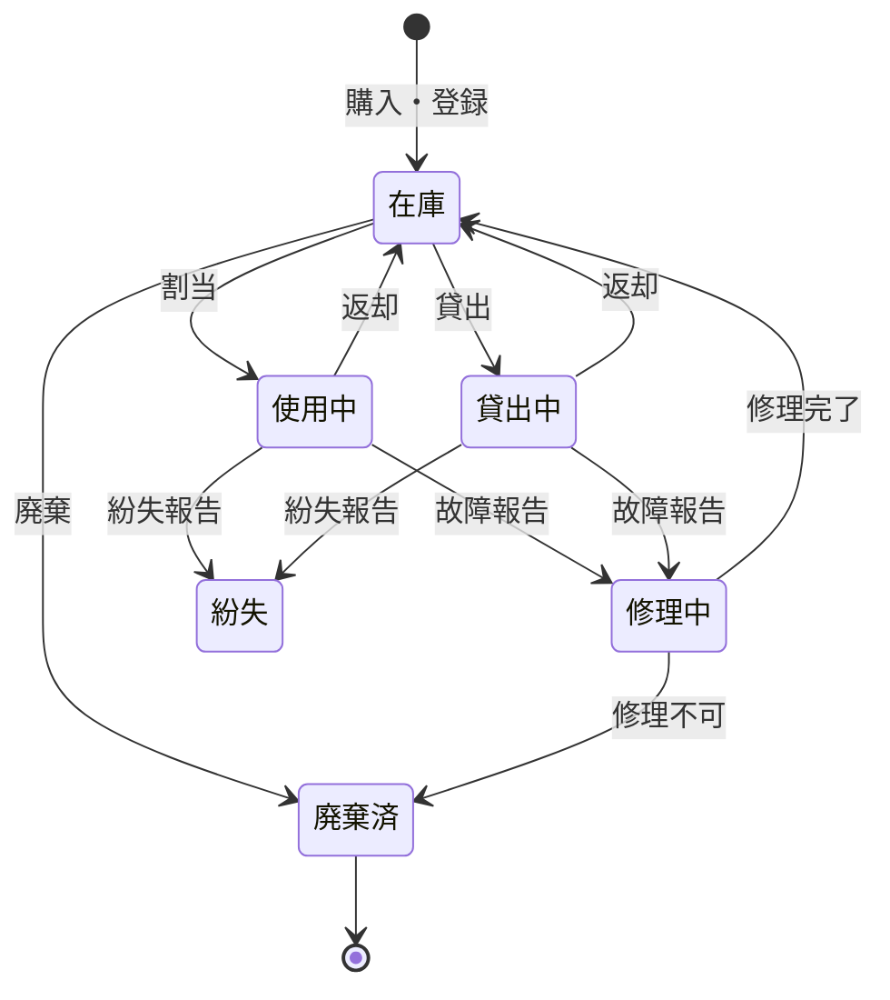
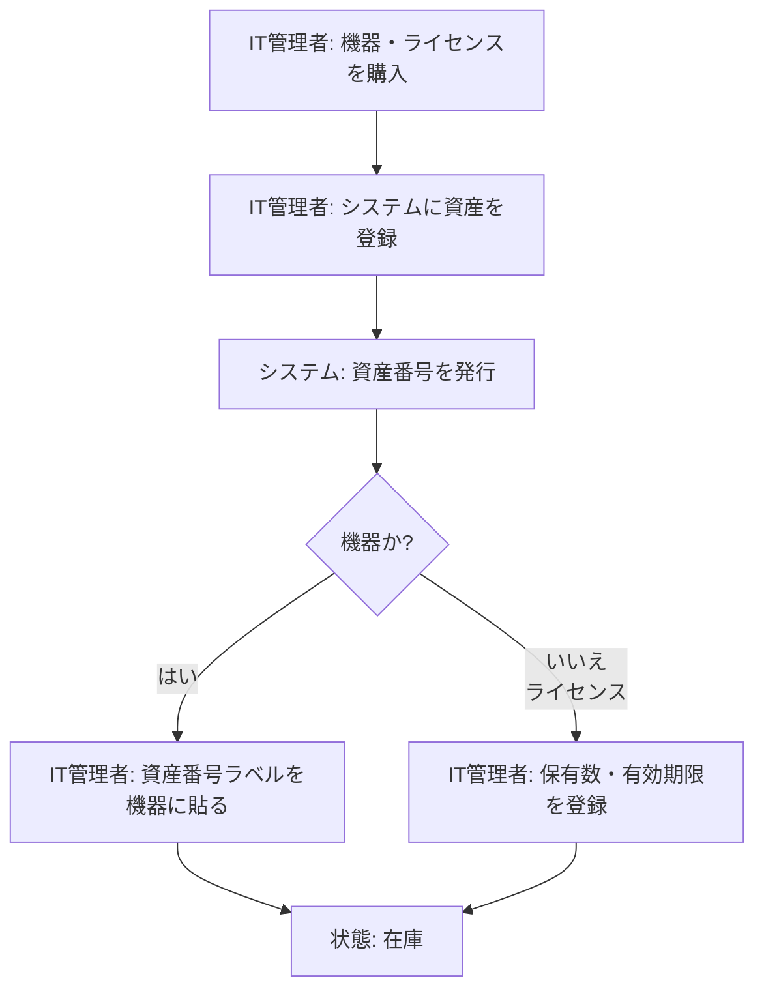
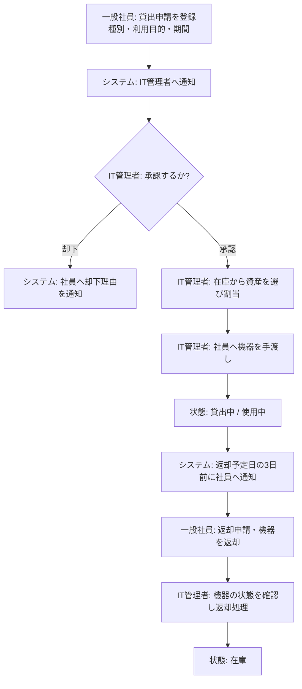
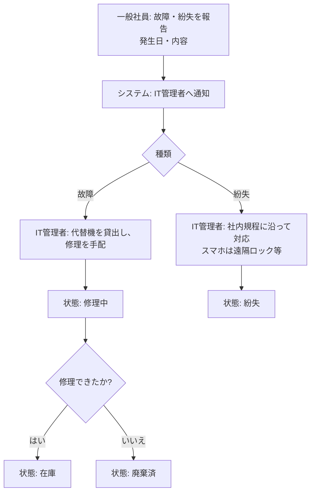
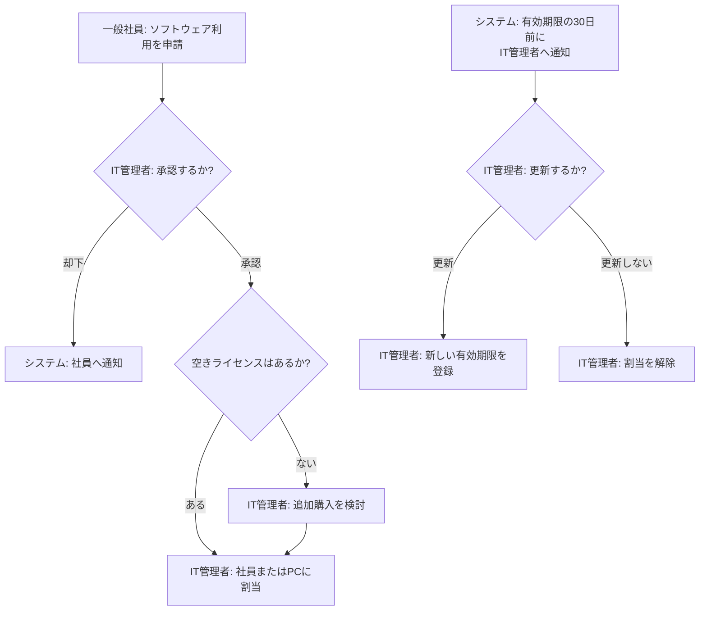
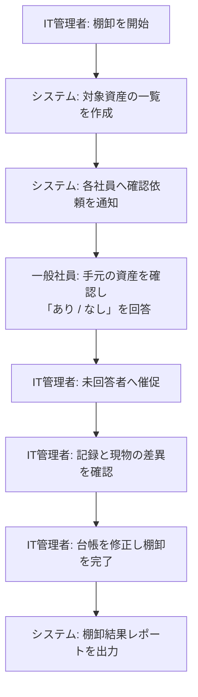
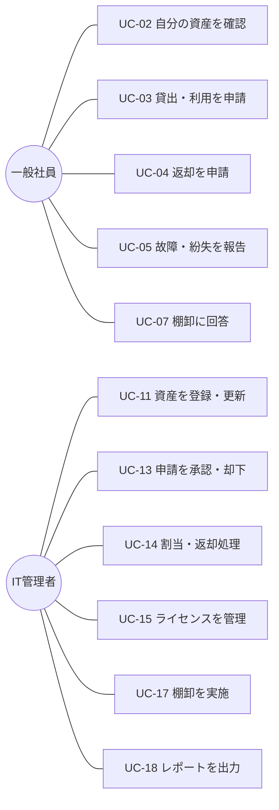

# 社内IT資産管理システム 要件定義書

| 項目 | 内容 |
|---|---|
| 版数 | 0.1（ドラフト） |
| 作成日 | 2026-10-31 |
| ステータス | レビュー前 |

> 本書の数値（社員数・資産数・応答時間など）は、ヒアリング前の**仮置きの想定値**です。確定値は「11. 未確定事項」で確認します。

---

## 1. 背景と目的

### 1.1 背景（想定される現状の課題）

- IT資産をExcelの台帳で管理しており、更新漏れや二重登録が起きる
- 「誰が・どの機器を・いつから」使っているかをすぐに答えられない
- ソフトウェアライセンスの保有数と利用数が合わず、超過利用や余剰購入が起きる
- 機器の貸出・返却の申請がメールや口頭で行われ、記録が残らない
- 棚卸（年1回の現物確認）に多くの工数がかかる

### 1.2 目的

1. IT資産の情報を1つのシステムに集め、最新の状態を誰でも確認できるようにする
2. 貸出・返却・故障報告の申請と承認をシステム上で完結させ、記録を残す
3. ライセンスの保有数と利用数を照合し、超過・余剰・期限切れを早めに把握する
4. 棚卸の作業時間を減らす

---

## 2. 対象範囲

### 2.1 管理対象

| 区分 | 例 | 主な管理項目 |
|---|---|---|
| PC | ノートPC、デスクトップPC | 資産番号、メーカー、型番、シリアル番号、OS、購入日、保証期限、利用者、設置場所、状態 |
| モニター | 外付けディスプレイ | 資産番号、メーカー、型番、シリアル番号、サイズ、購入日、利用者、設置場所、状態 |
| スマートフォン | 社用携帯 | 資産番号、メーカー、型番、IMEI（端末の識別番号）、電話番号、通信キャリア、契約期限、利用者、状態 |
| ソフトウェアライセンス | Office、PDF編集ソフト、ウイルス対策ソフト | ライセンス名、提供元、ライセンス形態、保有数、割当数、有効期限、費用、割当先（人またはPC） |

### 2.2 対象外（今回は扱わない）

- 周辺機器（キーボード、マウス、ヘッドセットなど）の個別管理
- ネットワーク機器・サーバーの管理
- PCの操作ログ取得、ソフトウェアの自動検出（エージェントの導入）
- 購買システム・会計システムとの連携（将来の検討事項）

---

## 3. 利用者と権限

| 利用者 | 説明 | 主にできること |
|---|---|---|
| 一般社員 | 機器やライセンスを使う社員 | 自分に割り当てられた資産の確認、貸出・返却・故障報告・ライセンス利用の申請、申請状況の確認 |
| IT管理者 | 情報システム部門の担当者 | 全資産の登録・更新・廃棄、申請の承認・却下、ライセンス割当、棚卸、レポート出力、利用者アカウントの管理 |

- 一般社員は**他の社員の資産情報を見られない**（自分の分のみ）。
- 上長承認は今回の範囲に含めない（必要かどうかは「11. 未確定事項」で確認）。

---

## 4. 用語の定義

| 用語 | 意味 |
|---|---|
| 資産 | 本システムで管理するPC・モニター・スマートフォン・ソフトウェアライセンスの総称 |
| 資産番号 | 会社が資産ごとに付ける一意の番号（例：`PC-0001`）。機器にラベルとして貼る |
| 割当 | 資産を特定の社員（またはPC）が使う状態にすること |
| 貸出 | 一時的な利用のために資産を割り当てること。返却予定日を持つ |
| 棚卸 | 台帳の記録と実際の機器が一致しているかを確認する作業 |
| ライセンス形態 | ライセンスの数え方。ユーザー単位（1人1つ）、デバイス単位（PC1台に1つ）、サブスクリプション（期間契約）など |
| 状態 | 資産の今の状況。「在庫」「使用中」「貸出中」「修理中」「紛失」「廃棄済」 |

### 4.1 資産の状態の移り変わり（PC・モニター・スマートフォン）

---

## 5. 業務フロー

導入後の業務の流れ（To-Be）を示します。

### 5.1 資産の登録（購入時）

### 5.2 貸出・利用申請から返却まで

### 5.3 故障・紛失の報告

### 5.4 ライセンスの割当と更新

### 5.5 棚卸（年1回）

---

## 6. ユースケース

### 6.1 ユースケース一覧

| ID | ユースケース | 一般社員 | IT管理者 |
|---|---|:---:|:---:|
| UC-01 | ログインする | ○ | ○ |
| UC-02 | 自分の資産を確認する | ○ | ○ |
| UC-03 | 貸出・利用を申請する | ○ | |
| UC-04 | 返却を申請する | ○ | |
| UC-05 | 故障・紛失を報告する | ○ | |
| UC-06 | 申請状況を確認する | ○ | ○ |
| UC-07 | 棚卸の確認依頼に回答する | ○ | |
| UC-11 | 資産を登録・更新する | | ○ |
| UC-12 | 資産を検索・一覧表示する | | ○ |
| UC-13 | 申請を承認・却下する | | ○ |
| UC-14 | 資産を割当・返却処理する | | ○ |
| UC-15 | ライセンスを管理する | | ○ |
| UC-16 | 資産を廃棄する | | ○ |
| UC-17 | 棚卸を実施する | | ○ |
| UC-18 | レポートを出力する | | ○ |
| UC-19 | 利用者アカウントを管理する | | ○ |

### 6.2 ユースケース図

### 6.3 主要ユースケースの詳細

#### UC-03 貸出・利用を申請する

| 項目 | 内容 |
|---|---|
| 利用者 | 一般社員 |
| 目的 | 業務で必要な機器・ソフトウェアを使えるようにする |
| 事前条件 | ログインしている |
| 基本の流れ | 1. 社員が申請画面を開く 2. 資産の種別（PC／モニター／スマートフォン／ソフトウェア）を選ぶ 3. 利用目的・利用開始日・返却予定日を入力する 4. 申請ボタンを押す 5. システムが申請番号を発行し、IT管理者へ通知する |
| 例外の流れ | 3a. 必須項目が空欄 → エラーを表示し、申請させない 3b. 返却予定日が利用開始日より前 → エラーを表示する 4a. 同じ種別で未完了の申請がある → 確認メッセージを表示する |
| 事後条件 | 申請が「承認待ち」で登録される |

#### UC-13 申請を承認・却下する

| 項目 | 内容 |
|---|---|
| 利用者 | IT管理者 |
| 目的 | 申請内容を確認し、資産を渡してよいか判断する |
| 事前条件 | 「承認待ち」の申請がある |
| 基本の流れ | 1. 管理者が承認待ち一覧を開く 2. 申請の内容を確認する 3. 「承認」を押す 4. 在庫の資産を選んで割当てる（UC-14） 5. システムが申請者へ承認を通知する |
| 例外の流れ | 3a. 「却下」を選ぶ → 却下理由の入力を必須とし、申請者へ通知する 4a. 在庫がない → 「保留」にし、申請者へ通知する |
| 事後条件 | 申請が「承認済」「却下」「保留」のいずれかになる |

#### UC-15 ライセンスを管理する

| 項目 | 内容 |
|---|---|
| 利用者 | IT管理者 |
| 目的 | ライセンスの超過利用・余剰・期限切れを防ぐ |
| 事前条件 | ライセンスが登録されている |
| 基本の流れ | 1. 管理者がライセンス一覧を開く 2. システムが保有数・割当数・残数・有効期限を表示する 3. 管理者が社員またはPCにライセンスを割当て、または解除する |
| 例外の流れ | 3a. 残数が0 → 割当できないことを表示する 2a. 有効期限まで30日以内 → 一覧で強調表示する |
| 事後条件 | 割当数と残数が更新され、操作履歴が残る |

#### UC-17 棚卸を実施する

| 項目 | 内容 |
|---|---|
| 利用者 | IT管理者（回答は一般社員：UC-07） |
| 目的 | 台帳の記録と現物を一致させる |
| 事前条件 | 実施中の棚卸がない |
| 基本の流れ | 1. 管理者が棚卸を開始し、回答期限を設定する 2. システムが「使用中・貸出中」の資産の利用者へ確認依頼を送る 3. 社員が資産ごとに「手元にある／ない」を回答する 4. 管理者が差異（「ない」と回答、未回答）を確認し、台帳を修正する 5. 管理者が棚卸を完了する |
| 例外の流れ | 3a. 期限を過ぎても未回答 → 未回答者一覧を表示し、催促を送る |
| 事後条件 | 棚卸結果レポートが出力できる |

---

## 7. 機能要件

優先度：**Must**＝初回リリースに必須／**Should**＝できれば初回に含める／**Could**＝将来の追加候補

### 7.1 共通

| ID | 機能 | 内容 | 優先度 |
|---|---|---|---|
| F-01 | ログイン | 社員IDとパスワードでログインする | Must |
| F-02 | 権限による表示制御 | 一般社員とIT管理者で使える画面・見られるデータを分ける | Must |
| F-03 | 通知 | 申請・承認・期限などのお知らせをシステム内とメールで送る | Should |

### 7.2 資産管理（IT管理者）

| ID | 機能 | 内容 | 優先度 |
|---|---|---|---|
| F-11 | 資産登録 | 種別ごとの項目を入力して登録する。資産番号は自動で発行する | Must |
| F-12 | 資産の更新 | 登録内容・状態を変更する | Must |
| F-13 | 資産の検索・一覧 | 種別・状態・利用者・部署・資産番号で絞り込む | Must |
| F-14 | 資産の詳細表示 | 1つの資産の情報と、割当・修理などの履歴を表示する | Must |
| F-15 | 一括登録 | CSVファイルから複数の資産をまとめて登録する（既存Excel台帳からの移行に使う） | Must |
| F-16 | 廃棄 | 状態を「廃棄済」にする。データは削除せず履歴として残す | Must |
| F-17 | 入力チェック | 資産番号・シリアル番号の重複、必須項目の空欄、日付の形式を確認する | Must |

### 7.3 割当・申請

| ID | 機能 | 内容 | 優先度 |
|---|---|---|---|
| F-21 | 貸出・利用申請 | 一般社員が種別・目的・期間を入力して申請する | Must |
| F-22 | 返却申請 | 一般社員が返却を申請する | Must |
| F-23 | 故障・紛失報告 | 一般社員が資産を選び、発生日と内容を報告する | Must |
| F-24 | 承認・却下 | IT管理者が申請を承認・却下・保留する。却下時は理由を必須とする | Must |
| F-25 | 割当・返却処理 | IT管理者が資産を社員に割当て、返却を受け付ける | Must |
| F-26 | 申請状況の確認 | 申請者が自分の申請の状況を確認する | Must |
| F-27 | 返却期限の通知 | 返却予定日の3日前と超過時に、社員とIT管理者へ通知する | Should |

### 7.4 ライセンス管理

| ID | 機能 | 内容 | 優先度 |
|---|---|---|---|
| F-31 | ライセンス登録 | 名称・形態・保有数・有効期限・費用を登録する | Must |
| F-32 | ライセンス割当 | 社員またはPCに割当て・解除する。残数が0なら割当できない | Must |
| F-33 | 利用状況の表示 | 保有数・割当数・残数を一覧で表示する | Must |
| F-34 | 期限の通知 | 有効期限の30日前にIT管理者へ通知する | Should |

### 7.5 棚卸

| ID | 機能 | 内容 | 優先度 |
|---|---|---|---|
| F-41 | 棚卸の開始・完了 | 回答期限を決めて棚卸を開始し、差異の確認後に完了する | Should |
| F-42 | 棚卸の回答 | 一般社員が自分の資産ごとに「ある／ない」を回答する | Should |
| F-43 | 差異の一覧 | 「ない」と回答された資産・未回答の資産を一覧表示する | Should |

### 7.6 レポート・その他

| ID | 機能 | 内容 | 優先度 |
|---|---|---|---|
| F-51 | 一覧のCSV・Excel出力 | 検索結果をCSV・Excel形式でダウンロードする | Must |
| F-52 | 集計レポート | 種別・状態・部署ごとの台数、ライセンス利用率を表示する | Should |
| F-53 | 操作履歴 | 誰が・いつ・何を変更したかを記録し、IT管理者が確認できる | Must |
| F-54 | 利用者管理 | 社員アカウントの登録・無効化、権限の変更を行う | Must |
| F-55 | 保証期限・契約期限の通知 | PCの保証期限、スマートフォンの契約期限が近づいたら通知する | Could |
| F-56 | 生成AIによる問い合わせ支援 | 「空いているノートPCはある？」などの質問に、台帳をもとに回答する | Could |

---

## 8. 非機能要件

機能要件が「何ができるか」なのに対し、非機能要件は「どれくらいの品質で動くか」を定めます。

| 区分 | ID | 要件 | 備考 |
|---|---|---|---|
| 規模 | N-01 | 利用者300名、資産2,000件、ライセンス50種類を扱える | 想定値。5年後に2倍でも動くこと |
| 性能 | N-02 | 一覧表示・検索は3秒以内に結果を表示する | 想定値 |
| 可用性 | N-03 | 平日9時〜18時に利用できる。夜間・休日の停止は許容する | 社内業務システムのため |
| セキュリティ | N-04 | ログインしないと利用できない | |
| セキュリティ | N-05 | パスワードはそのまま保存せず、元に戻せない形（ハッシュ化）で保存する | |
| セキュリティ | N-06 | 一般社員は自分以外の資産情報・申請を見られない | F-02 |
| セキュリティ | N-07 | 社内ネットワークからのみ接続できる | 外部公開しない |
| セキュリティ | N-08 | 通信は暗号化する（HTTPS） | |
| データ保全 | N-09 | データを毎日自動でバックアップし、30日分を保管する | |
| データ保全 | N-10 | 資産データは物理削除しない（廃棄済として残す） | 監査対応 |
| データ保全 | N-11 | 操作履歴を5年間保管する | 社内規程の確認が必要 |
| 使いやすさ | N-12 | 一般社員がマニュアルなしで申請できる画面にする | 申請は3画面以内で完了 |
| 使いやすさ | N-13 | 社内標準のブラウザ（Microsoft Edge、Google Chrome の最新版）で動く | |
| 運用・保守 | N-14 | 初心者でも保守しやすいよう、構成をシンプルにし、手順書を用意する | |
| 運用・保守 | N-15 | エラーの内容をログファイルに記録する | |
| 移行 | N-16 | 既存のExcel台帳をCSVに変換して取り込める | F-15 |
| 個人情報 | N-17 | 社員の氏名・メールアドレス・電話番号は業務に必要な範囲でのみ保持する | |

---

## 9. 主なデータ項目（概要）

詳しいデータ設計は次の「基本設計」で行います。ここでは必要なデータのまとまりだけ整理します。

| データ | 主な項目 |
|---|---|
| 社員 | 社員ID、氏名、部署、メールアドレス、権限（一般社員／IT管理者）、在籍状態 |
| 機器 | 資産番号、種別、メーカー、型番、シリアル番号（またはIMEI）、購入日、保証期限、状態、利用者、設置場所 |
| ライセンス | ライセンスID、名称、提供元、形態、保有数、有効期限、費用 |
| ライセンス割当 | ライセンスID、割当先（社員またはPC）、割当日、解除日 |
| 申請 | 申請番号、申請者、種別（貸出／返却／故障／紛失／ライセンス）、内容、状態、承認者、処理日 |
| 棚卸 | 棚卸ID、開始日、回答期限、資産ごとの回答、差異の有無 |
| 操作履歴 | 日時、操作者、対象、操作内容、変更前後の値 |

---

## 10. 前提条件と制約

- 社員情報（氏名・部署）は人事部から定期的にCSVで受け取る想定とする
- 既存の台帳はExcelで管理されている前提とする
- 初回リリースでは、社内の認証基盤（Microsoft Entra ID など）との連携は行わない
- 予算・開発体制は未定（「11. 未確定事項」参照）

---

## 11. 未確定事項（関係者への確認が必要）

| No | 確認したいこと | 確認先 | 影響する要件 |
|---|---|---|---|
| Q-01 | 実際の社員数・資産数・ライセンス種類数 | 情報システム部門 | N-01, N-02 |
| Q-02 | 貸出に上長の承認は必要か | 情報システム部門、各部署 | F-24、業務フロー5.2 |
| Q-03 | 社内の認証基盤（シングルサインオン）と連携すべきか | 情報システム部門 | F-01 |
| Q-04 | メール通知に使えるメールサーバーはあるか | 情報システム部門 | F-03 |
| Q-05 | 操作履歴の保管期間に関する社内規程 | 総務・内部監査 | N-11 |
| Q-06 | 既存Excel台帳の項目と、データの正確さ | 情報システム部門 | F-15, N-16 |
| Q-07 | 紛失時の社内規程（報告先、スマホの遠隔ロック手順） | 総務・情報システム部門 | 業務フロー5.3 |
| Q-08 | 予算、リリース希望時期、開発・運用の担当者 | 依頼部門 | 全体 |

---

## 12. 改訂履歴

| 版数 | 日付 | 内容 |
|---|---|---|
| 0.1 | 2026-10-31 | 初版作成 |
